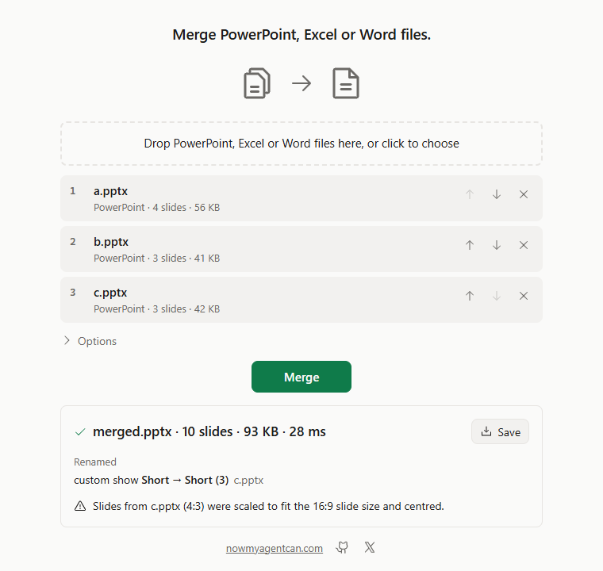

# doc-merge

Merge several PowerPoint, Excel or Word files into one file of the same kind, keeping each file's layouts, styles, charts and notes: a command line tool with JSON output, a local web page, and an MCP server for AI agents. Everything runs on your computer.



**Read [Known problems](#known-problems-in-v010) first: this release has open bugs, and it isn't for untrusted files in `ui` or `mcp`.**

## Install

Windows (PowerShell, no admin; installs to `%LOCALAPPDATA%\Programs\doc-merge` and adds it to your user PATH):

```powershell
irm https://github.com/nowmyagentcan/doc-merge/releases/latest/download/install.ps1 | iex
```

macOS and Linux (installs to `~/.local/bin`):

```sh
curl -fsSL https://github.com/nowmyagentcan/doc-merge/releases/latest/download/install.sh | sh
```

| System | Download |
|---|---|
| Windows x64 | [doc-merge-v0.1.0-windows-x64.zip](https://github.com/nowmyagentcan/doc-merge/releases/download/v0.1.0/doc-merge-v0.1.0-windows-x64.zip) |
| macOS Apple silicon | [doc-merge-v0.1.0-macos-arm64.tar.gz](https://github.com/nowmyagentcan/doc-merge/releases/download/v0.1.0/doc-merge-v0.1.0-macos-arm64.tar.gz) |
| macOS Intel | [doc-merge-v0.1.0-macos-x64.tar.gz](https://github.com/nowmyagentcan/doc-merge/releases/download/v0.1.0/doc-merge-v0.1.0-macos-x64.tar.gz) |
| Linux x64 | [doc-merge-v0.1.0-linux-x64.tar.gz](https://github.com/nowmyagentcan/doc-merge/releases/download/v0.1.0/doc-merge-v0.1.0-linux-x64.tar.gz) |
| Linux arm64 | [doc-merge-v0.1.0-linux-arm64.tar.gz](https://github.com/nowmyagentcan/doc-merge/releases/download/v0.1.0/doc-merge-v0.1.0-linux-arm64.tar.gz) |

With Rust: `cargo install --git https://github.com/nowmyagentcan/doc-merge --tag v0.1.0 --locked`. To remove it, delete the binary.

## Use

```sh
doc-merge a.pptx b.pptx c.pptx -o all.pptx
```

```
✓ all.pptx  10 slides from 3 files  93 KB  119 ms
  renamed  custom show Short → Short (3)  (c.pptx)
! Slides from c.pptx (4:3) were scaled to fit the 16:9 slide size and centred.
```

Files are merged in the order given, and the first file is the base: its theme, page setup and properties carry over. Give a folder or `"reports\*.docx"` to take its files in natural order. Without `-o` the result is `merged.<ext>` beside the first file, and nothing is ever overwritten unless you pass `--overwrite`. Word also takes `--styles first`, which gives every document the first one's styles instead of keeping each document's look.

`doc-merge` alone starts an interactive prompt where you can drop files. `doc-merge ui` opens a local page to drop files, put them in order and save the result; on Windows, double-clicking `doc-merge.exe` does the same.

### Use with AI agents

`--json` prints one JSON object: the output path, which slides, sheets or sections came from each file, every renamed item and the warnings. Errors are `{"error": {"code", "message", "hint", "input"}}`.

```sh
doc-merge a.pptx b.pptx -o all.pptx --json
doc-merge q1.xlsx q2.xlsx -o both.xlsx --json
doc-merge part1.docx part2.docx -o whole.docx --json
```

`doc-merge mcp` is a local MCP server on stdio with one tool, `merge_documents`:

| Agent | Setup |
|---|---|
| Claude Code | `claude mcp add doc-merge -- doc-merge mcp` |
| Codex | `codex mcp add doc-merge -- doc-merge mcp` |
| Cursor (`~/.cursor/mcp.json`), Claude Desktop | `{"mcpServers":{"doc-merge":{"command":"doc-merge","args":["mcp"]}}}` |
| VS Code (`.vscode/mcp.json`) | `{"servers":{"doc-merge":{"type":"stdio","command":"doc-merge","args":["mcp"]}}}` |

## Supported inputs and limits

It reads `.pptx`, `.potx`, `.ppsx`, `.xlsx`, `.xltx`, `.docx` and `.dotx`, one kind per merge, and writes `.pptx`, `.xlsx` or `.docx`.

- **PowerPoint** keeps every slide with its master, layouts and theme (identical designs are shared), notes, charts, comments, sections, custom shows and slide links. Slides of another size are scaled and centred.
- **Excel** copies every sheet with its formats, tables, charts, pictures, comments and names. Clashing sheets, tables and names are renamed and formulas rewritten to match.
- **Word** starts each document on a new page with its own page setup, headers and footers. Lists restart as in the source, and notes, comments and bookmarks come along. Clashing styles keep each document's look, apart from the default colour and spacing listed under Known problems.

Refused, naming the reason: macros, password-protected and old binary files, Strict Open XML, OpenDocument and `.xlsb`. In Excel files after the first: pivot tables, slicers, timelines, data models, queries, connections, images in cells, other cell metadata, XML maps, revision history, dialog sheets, and a different date system. In PowerPoint files after the first: zoom.

Sizes: 2 to 500 files, each up to 512 MiB and 2 GiB in all (the page holds 1 GiB), output under 2 GiB. `ui` and `mcp` stop a merge after 600 seconds.

What it doesn't do, or hasn't proven:

- Word: a table of contents isn't updated (you get a warning; update it in Word). Fields such as TITLE keep their last result and show the first file's properties once updated. Note settings that only the first file's settings set apply to every document. Shapes and charts take the first file's theme. Bookmarks are renamed on a clash, move range names aren't.
- Excel: built-in table style fills follow the first workbook's theme, so a table can change colour when the themes differ; so do shapes and charts.
- PowerPoint: legacy and modern comment authors stay in their own lists. Handout masters of later decks are left out. When a deck is scaled, SmartArt and charts scale as a frame and keep their inner sizes. A master shared between decks keeps its own links.
- Tested less: zoom refusal only on hand-built files, as PowerPoint can't be scripted to write one. OLE and ActiveX objects are copied by the same rules but were never opened in Office here, for lack of a test file. A custom table style's fill didn't draw in a test deck even in the source deck alone, so its look in a merge is unproven; PowerPoint does report the style by name.
- Closing the console window during a merge can leave a `.doc-merge-*.tmp` file beside the output; Ctrl+C doesn't.
- Running out of memory can't be turned into an error, in `ui` and `mcp` too. Four ordinary Word files of 500 MiB of XML each merged within 3 GB; for files built to do it, see below.

### Known problems in v0.1.0

Not fixed in this release, worst first:

- **Word asks to repair one merge, after exit 0.** A script-edited test file with a footnote and an endnote marked `w:type="normal"` merges, its note text arrives, and Word then asks to repair the output. That file asks for repair when opened alone too, and the cause in the output wasn't traced. A file with only such a footnote merges and opens with no prompt.
- **Don't feed untrusted files to `ui` or `mcp`.** A file of about 200 KB (parts of 64 MiB made of tiny elements) exhausted a 2 GiB memory cap, and the command line tool hadn't exited 90 seconds later. The cause isn't proven, and `ui` and `mcp` were never run under a cap.
- **Word: the first document's default colour and spacing leak into later documents.** When only the first document's defaults set them, merged text takes them: on a report template, body text went from automatic to the template's grey and space before from 0 to 2 pt. 7 of the 23 templates shipped with Office 2021 carry a default colour. No text is lost.
- **Word: table cell spacing changes** when the documents' defaults differ. On that same merge, cell paragraphs went from 0 after and line 12 to 8 after and line 13.9.

Smaller ones are in the [release notes](https://github.com/nowmyagentcan/doc-merge/releases/tag/v0.1.0), along with speed:

- Excel: default column widths and row heights follow the first workbook's font, so dates can show `######`. The values are intact.
- A damaged file can stop with `internal`, exit 3, where it should say `bad_package`. A few crafted files are accepted, and their output doesn't open.
- The largest case is slower than the goal: a Word file with 200 MB of `document.xml` took 12.6 s on Windows against a 5 s target.

This release had one shortened test pass and no independent review. Not tested: 47 of the 76 merges in the Word test set (their opens timed out), about 27 of the 30 hostile files, and `ui` and `mcp` under a memory cap. The last fixes got one short check in Office 2021: outputs of the three bugs fixed last opened with no prompt, apart from the merge above.

It makes no network requests: no update check, no telemetry. `ui` listens on 127.0.0.1 only and keeps everything in memory, and `mcp` speaks only on stdin and stdout.

## How it works

Each input is read as a ZIP package with its limits checked, the merge is planned part by part, and the package is written with every untouched part copied byte for byte, so what the tool doesn't know about survives. A check of the planned package runs before anything is saved, and the file appears only when complete.

It uses [zip](https://github.com/zip-rs/zip2) and [quick-xml](https://github.com/tafia/quick-xml) for packages and XML, [rmcp](https://github.com/modelcontextprotocol/rust-sdk) for MCP and [clap](https://github.com/clap-rs/clap) for arguments. The merge rules learned from [docxcompose](https://github.com/4teamwork/docxcompose), [Open-Xml-PowerTools](https://github.com/OfficeDev/Open-Xml-PowerTools), [Clippit](https://github.com/sergey-tihon/Clippit) and [pptx-automizer](https://github.com/singerla/pptx-automizer); no code is copied. Icons are from [Phosphor](https://phosphoricons.com) (MIT).

## First run on an unsigned build

Windows: if "Windows protected your PC" appears, choose More info, then Run anyway.
The install script doesn't trigger it; a zip extracted in Explorer may.

macOS: if it says the developer can't be verified, open System Settings, Privacy & Security, and choose Open Anyway.
The install script doesn't trigger it, because curl downloads carry no quarantine flag.

## Licence

Apache-2.0, see [LICENSE](LICENSE). Each release archive includes `THIRD-PARTY-LICENSES.txt` for the bundled dependencies.

---

[nowmyagentcan.com](https://nowmyagentcan.com) · [x.com/chayp05](https://x.com/chayp05)
